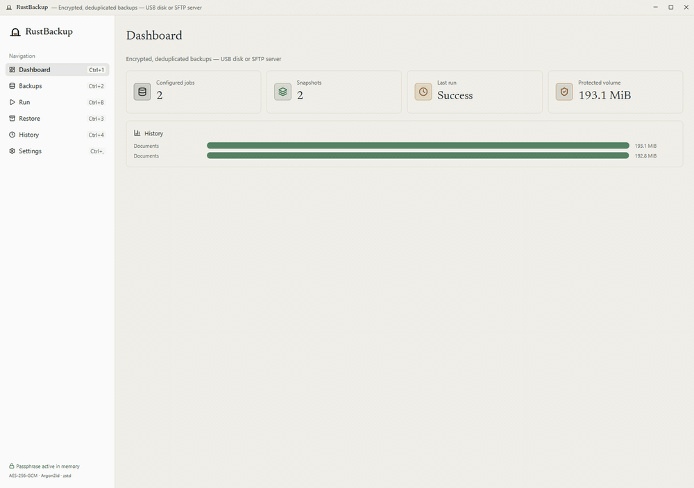
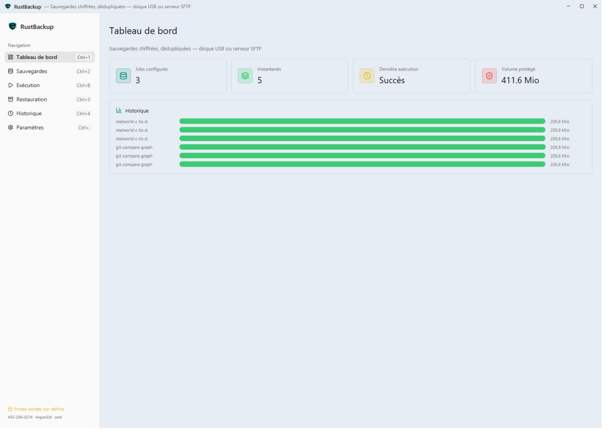
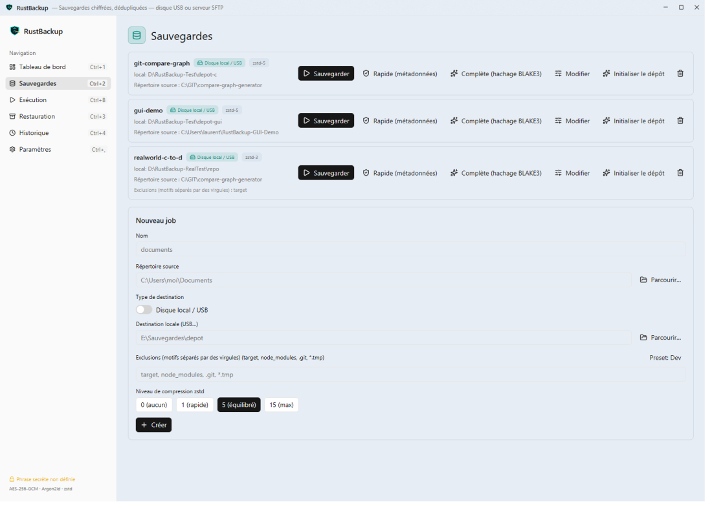
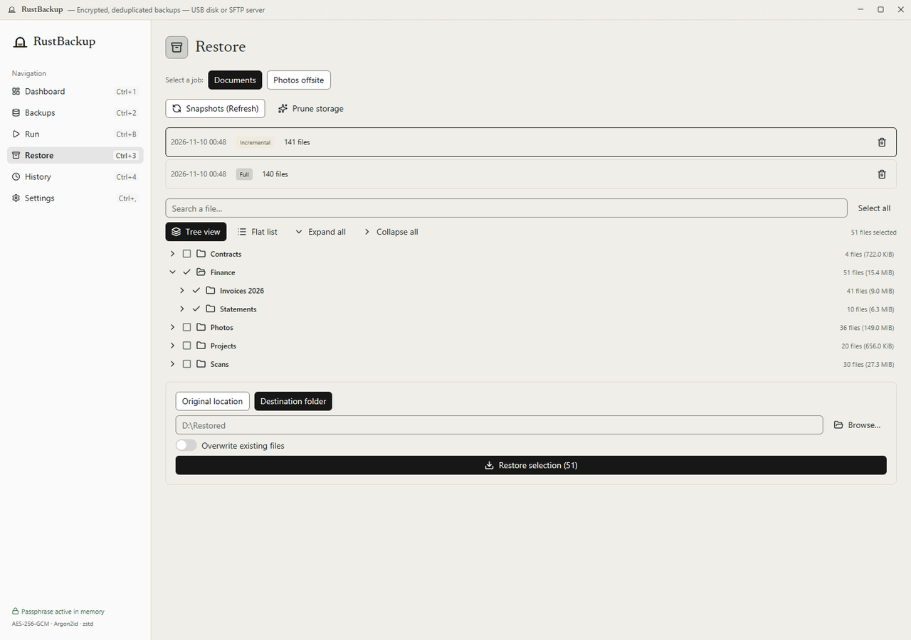
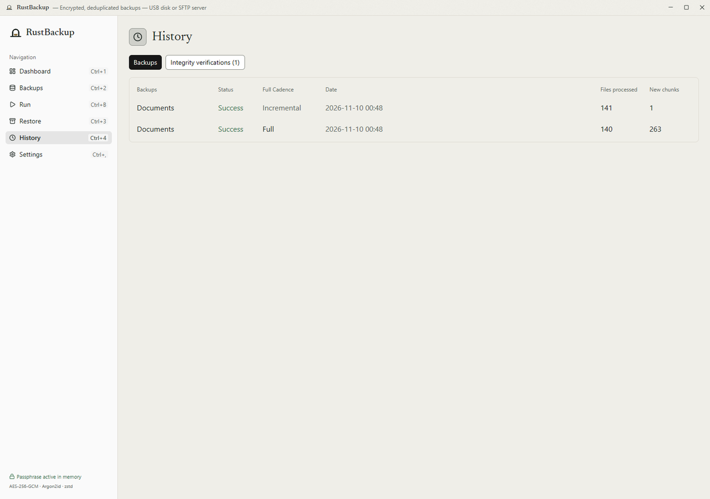
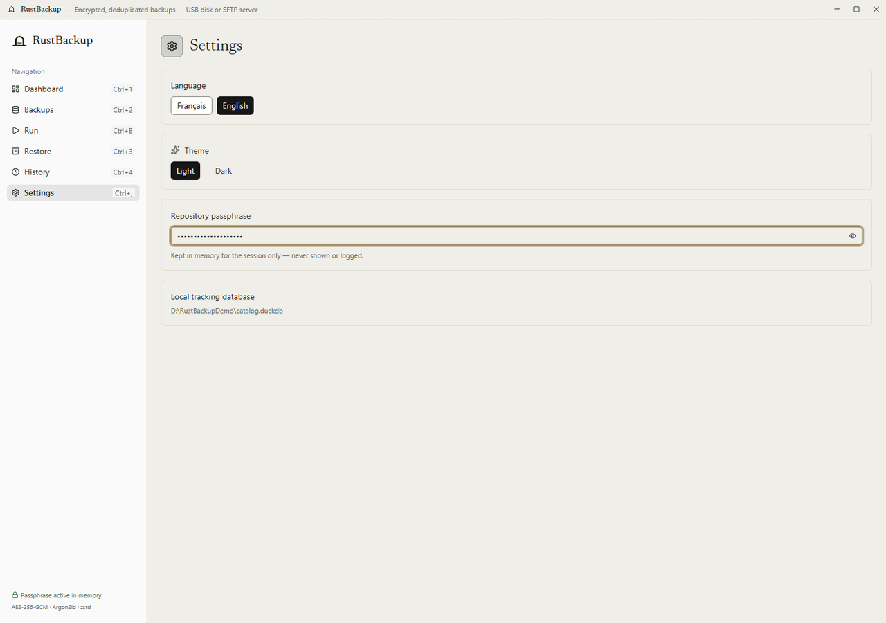
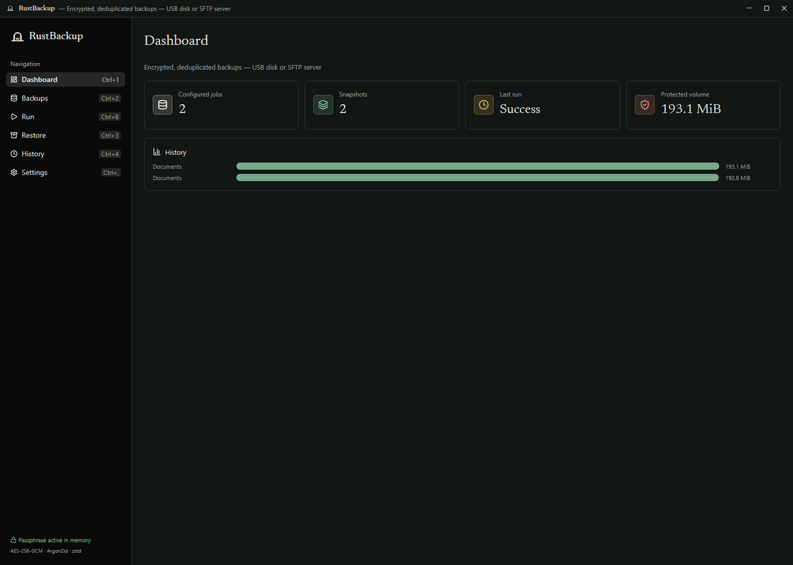

<p align="center">
  
</p>

<h1 align="center">RustBackup</h1>

<p align="center">
  <strong>Fast, encrypted, content-defined deduplicated backups for Windows & Linux remote servers.</strong>
</p>

<p align="center">
  
  
  
  
  
  
  
</p>

---

## 📌 Keywords & Topics

`rust` · `backup` · `deduplication` · `fastcdc` · `blake3` · `aes-256-gcm` · `argon2id` · `sftp` · `gpui` · `gpui-kit` · `desktop-app` · `windows` · `duckdb` · `data-integrity` · `cryptography`

---

## 🚀 Overview

**RustBackup** is a modern desktop backup application engineered in Rust for high throughput, cryptographic confidentiality, and content-defined storage efficiency. It pairs a headless core engine (`rb-core`) and CLI (`rbackup`) with a GPU-accelerated desktop interface built on **GPUI Kit** (Zed's GPUI engine with Longbridge component architecture).

Whether backing up directly to external USB drives, local NVMe volumes, or offsite Linux servers via secure SFTP, RustBackup treats repositories as **self-contained, sovereign vaults**.

---

## ✨ Key Features

- **Full Backup, Then Incremental Forever & Configurable Full Cadence**  
  Content-defined chunking with **FastCDC v2020** (256 KiB / 1 MiB / 4 MiB) combined with **BLAKE3** content addressing. A second run against an unchanged directory stores **zero new bytes** in fractions of a second. Automatically schedules a Full backup after $X$ incremental backups (default: 10, configurable per job or set to 0 to disable), or force a Full backup on demand at any time (`--full` or GUI toggle).
- **Encrypt-Then-Store AEAD Cryptography**  
  Each chunk is compressed with **zstd**, then sealed using **AES-256-GCM** with a fresh 96-bit random nonce. Associated data strictly binds `BLAKE3(plaintext) || plain_len` to prevent chunk-swapping or truncation attacks. The 256-bit master key is encrypted via **Argon2id** (64 MiB, $t=3$, $p=4$) and zeroized in memory on drop.
- **Self-Contained Repository Format (v1)**  
  Contains `config.json`, `keys/`, `chunks/`, and `snapshots/`. Restoring or verifying data requires **only the repository and passphrase** — zero dependence on the local database.
- **Dual Storage Backends**  
  - **Local Filesystems**: USB drives, external SSDs, internal mount points.
  - **Remote SFTP**: Linux servers via `russh` & `russh-sftp` using SSH public-key authentication (OpenSSH / PEM, passphrase-protected keys, and TOFU host-key pinning).
- **Atomic Operations by Design**  
  All chunks and manifests land via temporary files and atomic rename. Interrupted or killed runs never produce a corrupted snapshot. Source files are opened read-only and **never modified or deleted**.
- **Partial & Granular Restores**  
  Restore single files or entire directory subtrees to their original paths or a custom destination, with hierarchical tree browsing, skip/overwrite policies, and exact modification time (`mtime`) restoration.
- **Dual-Depth Integrity Verification**  
  - **Quick**: Validates manifest cryptographic authentication and referenced chunk presence.
  - **Full**: Reads, decrypts, and re-computes BLAKE3 hashes for every chunk to detect silent bit rot.
- **Snapshot Deletion & Orphan Chunk Pruning (Garbage Collection)**  
  Safely delete obsolete snapshot manifests with interactive modal confirmation (`AlertDialog`). Reclaim storage space by unlinking unreferenced orphan chunks while preserving shared data.
- **Cooperative Exclusive Repository Locking**  
  Prevents conflicting concurrent backups or maintenance runs across processes or threads via atomic JSON locks (`locks/<id>.json`) with automatic release on drop and stale-lock recovery.
- **Local DuckDB Tracking Catalog**  
  High-performance local embedded database tracking jobs, execution statistics, snapshot metadata, and verification history.
- **Hardware-Accelerated Native GUI**  
  Built with **GPUI Kit 0.9.0**, rendering at 120 FPS with minimal memory overhead, bilingual French (default) / English interface, keyboard shortcuts (`Ctrl+1..4`, `Ctrl+B`, `Ctrl+,`), and steel-blue / dark theme support.

---

## 🖼️ Application Preview

<p align="center">
  
</p>

### 📸 Native GPUI Interface Views

| **Dashboard (Protected Volumes & Stats)** | **Backup Jobs & Destination Config** |
| :---: | :---: |
|  |  |
| **Granular Restore & Prune Maintenance** | **Execution & Verification History** |
|  |  |
| **Settings & Bilingual Switch (FR/EN)** | **Dark Mode & Hardware Acceleration** |
|  |  |

---

## ⚡ Performance Benchmarks

*Measured on Windows 11 with NVMe source backing up to a USB 3.0 external drive:*

| Run Type | Files Scanned | Data Volume | Execution Time | New Chunks Stored | Efficiency |
| :--- | :--- | :--- | :--- | :--- | :--- |
| **Initial Full Run** | 6,875 files | 215.6 MB | **26.8 s** | 6,416 chunks (108 MB on disk) | 50% zstd compression |
| **Unchanged Rerun** | 6,875 files | 215.6 MB | **0.43 s** | **0 chunks (0 B)** | 100% deduplication |
| **Incremental Run** | 6,876 files (+1 edit) | 215.7 MB | **0.31 s** | **2 chunks (27 B)** | Instant delta storage |
| **Integrity Verify** | 6,418 chunks | 108 MB | **2.1 s** | 0 corruptions, 0 orphans | Full BLAKE3 verify |
| **File Restore** | 20.6 MB DLL + 4.7 MB GIF | 25.3 MB | **0.18 s** | Restored byte-identical | SHA-256 match 100% |

### 🔀 SFTP Pipeline Throughput (LAN, NTFS-via-FUSE destination)

*Synthetic corpus (805 files, 1.04 GiB, 1 221 chunks) to a LAN server whose backup disk is a
USB 3 TB HDD mounted as NTFS through ntfs-3g on Linux, RTT < 1 ms:*

| Engine | Parallel upload writers | Wall time | Average throughput |
| :-- | :--- | :--- | :--- |
| v1 sequential (per-chunk SFTP round trips) | 1 | 299 s | 3.5 MiB/s |
| v2 pipeline (per-chunk fsync) | 4 | 127 s | 8.2 MiB/s |
| v2 pipeline (per-chunk fsync), `RBACKUP_UPLOAD_WORKERS=8` | 8 | 71 s | 14.7 MiB/s |
| **v2 pipeline, batched durability + one SSH connection per writer** | **8** | **64.5 s** | **16.1 MiB/s** |

*Small-file corpus (4 000 files of 4-128 KiB, 256 MiB), same server:* 45.5 s with per-chunk
fsync (4 writers) → **25.8 s** with batched durability and 8 writers. Reproduce with
`scripts/make_bench_corpus.py` + `scripts/bench_sftp.sh`.

**Pack files (repository format v2):** new chunks are stored in ~16 MiB pack files (restic/kopia style)
instead of one file per chunk, so the same 4 000-file corpus lands in 10 files on the server:
45.5 s → 25.8 s → **16.0 s**; mixed corpus 74.6 s → 64.5 s → **57.0 s**. Per-file and per-directory
restore read only the needed byte ranges. Format and crash-consistency rules: `docs/design/pack-format.md`,
`docs/REPO_FORMAT.md`. Older repositories (one file per chunk) stay readable.

On that destination the remaining ceiling is physical: the USB HDD writes ~60 MB/s
sequentially and accepts ~170 new files/s through ntfs-3g whatever the client (measured
with an independent SFTP client), so many small chunk files and several interleaved
streams are what costs time — not the client CPU, which stays mostly idle.

The storage engine pipelines: the walk thread only reads/chunks/hashes, worker threads
compress and seal in parallel (all CPU cores), and parallel upload writers — each on its
own SSH connection — store the chunks. Dedup membership comes from an in-memory index built
once per run — no per-chunk existence round trip. Durability is batched over SFTP: chunks
are written under temp names without a per-chunk fsync, one remote `sync` per batch makes
them durable, then the batch is renamed into place (manifests still finalized last;
accounts limited to SFTP fall back to a per-chunk fsync, `RBACKUP_SFTP_DURABILITY=fsync`
forces it — see `docs/REPO_FORMAT.md`). `RBACKUP_UPLOAD_WORKERS` is clamped to 32;
`RBACKUP_SFTP_WRITERS=channel` puts the writers back on one shared connection (then
OpenSSH's `MaxSessions`, default 10, caps them). `RBACKUP_PROFILE=1` prints per-stage
timings at the end of a run.

---

## 🏗️ Architecture & Crates

```
rust-backup (Cargo Workspace)
├── crates/rb-core        Engine library (zero GUI dependencies)
│   ├── backend/          StorageBackend trait: LocalFs & SftpBackend
│   ├── chunker.rs        FastCDC v2020 chunker (256 KiB / 1 MiB / 4 MiB)
│   ├── hash.rs           BLAKE3 ChunkHash
│   ├── compress.rs       zstd compression with strict length checking
│   ├── crypto.rs         MasterKey (zeroized), Argon2id wrap, AES-256-GCM AEAD
│   ├── repo.rs           Repository v1 format (config, keys, chunks, snapshots)
│   ├── manifest.rs       SnapshotManifest schema and serialization
│   ├── backup.rs         Pipelined walk -> chunk -> dedup index -> parallel store
│   ├── restore.rs        Plan resolution -> streaming verify -> atomic restore
│   ├── verify.rs         Quick & Full repository integrity verifier
│   └── catalog.rs        DuckDB database migrations & analytics
│
├── crates/rb-cli         `rbackup` headless CLI binary
└── rust-backup           Native GUI desktop application (GPUI Kit 0.9.0)
```

---

## 🛠️ Getting Started

### Prerequisites

- **OS**: Windows 11 (x86_64) or Linux
- **Rust Toolchain**: Rust 1.85+ (MSVC on Windows)
- **C++ Build Tools**: Visual Studio Build Tools with C++ workload & CMake on PATH

### Building from Source

```bash
git clone https://github.com/laurentvv/rust-backup.git
cd rust-backup

# Run verification gate (all targets & integration tests)
cargo test --workspace --locked

# Launch the GPU-accelerated desktop application
cargo run --release --bin rust-backup
```

---

## 💻 CLI Usage (`rbackup`)

The repository passphrase is read from `RBACKUP_PASSPHRASE` (never passed as a CLI flag or logged):

```bash
export RBACKUP_PASSPHRASE="your-secure-random-passphrase"

# 1. Initialize an encrypted repository (Local USB or SFTP)
rbackup repo init --dest E:\Backups\vault
# Or on a remote Linux server:
# rbackup repo init --sftp-host 192.168.1.100 --sftp-user backup --sftp-key ~/.ssh/id_ed25519 --sftp-root /srv/backup

# 2. Configure a backup job (optional --max-incrementals, default 10, 0 to disable)
rbackup jobs add --name work-docs --source C:\Users\Laurent\Documents --local-root E:\Backups\vault --max-incrementals 10

# 3. Run a backup (auto-incremental or auto-full by cadence, or force full with --full)
rbackup backup --job work-docs
# Or force a full scan:
# rbackup backup --job work-docs --full

# 4. List snapshots
rbackup snapshots --job work-docs

# 5. Verify repository integrity
rbackup verify --job work-docs --full

# 6. Restore files or folders
rbackup restore --job work-docs --snapshot <snapshot-uuid> --path Documents/project --to D:\Restored

# 7. Delete an obsolete snapshot
rbackup delete-snapshot --job work-docs --snapshot <snapshot-uuid>

# 8. Prune orphan chunks to reclaim storage
rbackup prune --job work-docs
```

---

## 🔒 Security Design

- **Zero Secret Leakage**: Passphrases and master keys are never stored in plain text, logged, or emitted in error traces.
- **Tamper Resistance**: Associated Data (AD) binds each chunk's content hash and plaintext length to the AEAD tag. Modifying any bit of a chunk on disk causes an instant authentication failure.
- **Read-Only Sources**: The engine opens source directories strictly read-only.
- **SSH TOFU Pinning**: Remote SFTP server host keys are checked against a local `known_hosts` fingerprint file on first use, rejecting silent host key changes.

For detailed security specifications, see [docs/SECURITY.md](docs/SECURITY.md) and [docs/REPO_FORMAT.md](docs/REPO_FORMAT.md).

---

## 📄 License

Licensed under the Apache License, Version 2.0. See [LICENSE](LICENSE) for details.
